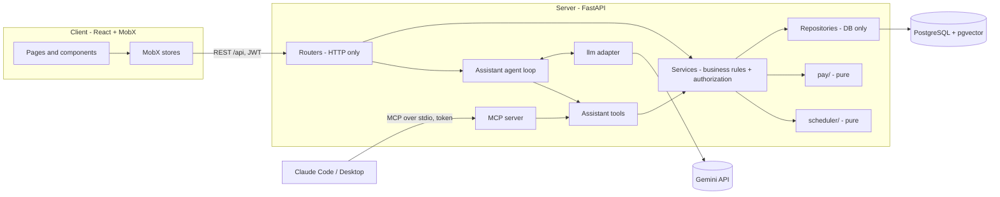

# Shibutzim

[](https://github.com/Yosef-Perelman/Shibutzim/actions/workflows/ci.yml)

**Shift scheduling and pay for small teams of hourly workers, with an AI assistant that answers questions about
shifts, hours, pay and company policy from real app data.**

*Shibutzim* (שיבוצים) is Hebrew for "assignments": assigning employees to shifts.

## The problem

A café, a small clinic or a shop usually schedules by hand. The manager collects availability over chat, builds the
week in a spreadsheet and reposts it after every change, so nobody knows which version is current. Hours are
reconstructed at month end, overtime rules (daily tiers, split shifts, shifts that cross midnight) are applied
inconsistently, and every policy question lands on the manager.

Shibutzim is one place to collect availability, generate and publish a schedule, record actual work, compute pay
deterministically, and ask questions in plain language.

## What it does

| | Manager (desktop) | Employee (phone) |
|---|---|---|
| **Schedule** | define shifts, generate a week with a constraint solver, edit, publish | see the published schedule |
| **Availability** | ask the assistant who can work a shift | say which shifts of next week they can or prefer to work |
| **Time and pay** | correct entries, see everyone's hours and pay | clock in and out, see own hours and a pay breakdown |
| **Team** | add people, deactivate and reactivate them | – |
| **Assistant** | "who can work Tuesday morning?", "build next week, Dana can't work Tuesday" (a proposal to confirm) | "how many overtime hours did I work?", "can I swap a shift?" (answers cite the handbook section) |

## Demo

<!-- TODO(author): after the first deployment, put the Cloud Run address here and add 2-3 screenshots
     (schedule board, my shifts at 375 px, the assistant) and a short GIF under docs/media/. -->

*The live demo address is added after the first deployment.* Demo accounts share one password,
`shibutzim-demo`: the manager `dana@shibutzim.example` and the employees `noa@`, `omer@`, `tamar@`, `yonatan@`
and `lior@shibutzim.example`. The site holds demo data only.

The app installs on a phone home screen (PWA).

## How it is built



- **Same core, two interfaces.** REST and MCP are thin entry points over one service layer, so authorization and
  business rules exist once. The in-app assistant and the MCP server share the same tools.
- **Authorization lives in services.** Not in routers, not in the client, not in prompts.
- **`pay/` and `scheduler/` are pure modules** with exhaustive tests: pay is `Decimal` arithmetic over time
  entries; the scheduler is a backtracking solver with forward checking and a trace mode that explains why a shift
  could not be filled.
- **The LLM is bounded by code.** It chooses tools and phrases answers; it never computes a number or a schedule,
  and a write is only ever a proposal that a human confirms.
- Server: Python 3.12, FastAPI, SQLAlchemy, Alembic, PostgreSQL with pgvector. Client: React, TypeScript, MobX,
  Mantine. Details and the reasoning behind each choice: [docs/architecture.md](docs/architecture.md).

## Run it locally

You need Docker, [uv](https://docs.astral.sh/uv/) and Node 24.

```bash
docker compose up -d db                      # PostgreSQL with pgvector on port 5433
cd server
uv sync
uv run alembic upgrade head
uv run python scripts/seed.py                # the demo team and a few weeks of data
uv run fastapi dev app/main.py               # API on http://localhost:8000 (docs at /docs)
```

```bash
cd client
npm ci
npm run dev                                  # http://localhost:5173, /api is proxied to the server
```

Sign in as `dana@shibutzim.example` (manager) or `noa@shibutzim.example` (employee) with the seed password
(`shibutzim-demo`). To see the production shape instead, run the image the deployment uses:

```bash
docker compose --profile app up -d --build   # http://localhost:8080
```

Every setting is documented in [.env.example](.env.example); copy it to `.env` only to change a default.

```bash
cd server && uv run pytest -q                # server tests (needs the database)
cd client && npm run lint && npm run typecheck && npm test
```

## The assistant

A chat (the Assistant screen) answers questions about shifts, hours, pay and company policy, and prepares a
schedule proposal for managers. It calls tools that run the same services as the app, as the signed-in user;
policy answers come from the employee handbook and name the section they used. See
[docs/architecture.md](docs/architecture.md) §6.4–§6.7.

To enable it, put a Gemini API key in `.env` (see `.env.example`), then:

```bash
cd server
uv run python scripts/ingest_handbook.py   # embeds the handbook once
uv run python -m evals.run --list          # the fifteen eval cases; --only <ids> runs a few
```

Without a key every other screen works and the assistant answers "not available". Tests never call a real model;
the evals do, on demand, within the provider's free quota.

## Use the tools from Claude Code or Claude Desktop (MCP)

The same tools are available over the [Model Context Protocol](https://modelcontextprotocol.io), as one user, with
that user's role: a manager's token offers the team tools, an employee's the personal ones. Calls are authorized by
the same services and land in the same tool-call log.

```bash
# 1. a token for the user the client should act as (valid 8 hours)
curl -s -X POST localhost:8000/api/auth/login -H 'content-type: application/json' \
  -d '{"email":"dana@shibutzim.example","password":"shibutzim-demo"}'

# 2. Claude Code
claude mcp add shibutzim --env SHIBUTZIM_MCP_TOKEN=<access_token> -- \
  uv run --directory /absolute/path/to/Shibutzim/server python -m app.mcp
```

For Claude Desktop, add the same command to `claude_desktop_config.json`:

```json
{
  "mcpServers": {
    "shibutzim": {
      "command": "uv",
      "args": ["run", "--directory", "/absolute/path/to/Shibutzim/server", "python", "-m", "app.mcp"],
      "env": { "SHIBUTZIM_MCP_TOKEN": "<access_token>" }
    }
  }
}
```

The server uses the database named by `DATABASE_URL`. A wrong or expired token stops it with a message; deactivating
the user cuts a running server off at the next request.

## Deployment

Every push to `main` runs the checks (server, client, image) and then deploys one container to Google Cloud Run,
against Supabase PostgreSQL, with secrets in Secret Manager and no stored cloud key. The one-time setup, releasing,
rollback and costs are in [docs/deployment.md](docs/deployment.md).

## How this was built with AI

The project is built with an AI coding agent (Claude Code), and the process is part of the work. The agent never
starts from a blank prompt: it starts from files that say what to build, how, and what it may not do.

1. **Docs first.** [Product definition](docs/product-definition.md) (what and why),
   [architecture](docs/architecture.md) (how, with a decision log) and a [glossary](docs/glossary.md) (one word per
   concept, used in code, database and API) were written before code. They describe the current state and are
   updated in the same change as the code.
2. **Rules.** [`docs/rules/`](docs/rules): coding, naming, database, error handling, testing, UI, style, planning
   and git. They turn the architecture into checkable habits, for example "services authorize, routers never do".
3. **Plans.** No implementation starts without a written plan the human approved
   ([planning rules](docs/rules/planning-rules.md)). Each plan has a goal, scope in and out, assumptions, steps,
   validation, rollback and open questions with a suggested answer. [`plans/`](plans) holds all of them, in order,
   with a "what changed vs. plan" section filled in when each closes. The commit history reads
   docs → plan → tests → code, and `git log --first-parent main` shows one line per plan.
4. **Guardrails and hooks.** [`.claude/settings.json`](.claude/settings.json) and [`.claude/hooks/`](.claude/hooks)
   enforce rules the agent cannot talk its way around: `.env` files are never read or edited, committed migrations
   are never edited, `ruff` and the test suite run after every Python edit and failures are fed back, force-push and
   `rm -rf` are denied, and every session is archived.
5. **Subagents.** [`.claude/agents/`](.claude/agents): `backend` (server code only), `frontend` (client code only)
   and `qa` (writes tests and evals, read-only on source).
6. **Skills.** [`.claude/skills/`](.claude/skills): `new-plan` (draft the next plan from the roadmap and stop for
   approval), `new-endpoint` (tests first, then schema, repository, service, router), `add-pay-rule` (a fixed
   five-case test matrix per rule) and `debug-schedule` (explain why the solver could not fill a week).
7. **Evals.** The assistant is tested like code: fifteen fixed cases drive the real agent loop against the seeded
   database and a real model, checking which tools were called, that every stated number comes from a tool result,
   that policy answers cite their section, and that forbidden requests are refused
   ([`server/evals/`](server/evals)). Unit and API tests use a scripted fake model and never call a real one.

Four things are never compromised, whatever the deadline: pay tests, scheduler tests, authorization in services,
and the docs and plans trail.

What the process caught is part of the story too: a real API key committed in an example file was found before it
was published, the local history was rewritten and the key revoked, and plan 005's review changed its scope (a Team
screen was added) before any code was written.
