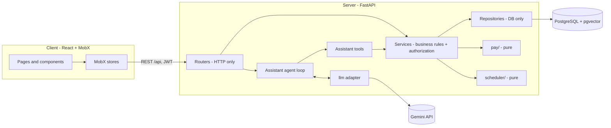

# Shibutzim – Architecture

> *How* the product described in [product-definition.md](product-definition.md) is built.
> Vocabulary is defined in [glossary.md](glossary.md). Coding, DB, testing and other rules live in `docs/rules/`.

## 1. Stack

| Layer | Choice | Why |
|---|---|---|
| Server | Python 3.12, **FastAPI**, Pydantic v2 | typed request/response schemas; async-ready; first-class OpenAPI |
| Database | **PostgreSQL + pgvector**, SQLAlchemy 2, Alembic | one database for app data **and** embeddings; no separate vector store to run or secure |
| Local environment | Docker Compose (Postgres with pgvector, host port 5433) | the same database engine locally and in production |
| Client | React + Vite + **TypeScript**, **MobX**, Mantine | typed UI; MobX stores keep server state out of components; Mantine gives accessible components without custom CSS work |
| Auth | email + password (bcrypt), JWT carrying the role; checked on the server | simple and sufficient; OAuth adds nothing for a single-organization demo |
| AI | one `llm` interface (chat with tool calling + embeddings); provider: **Gemini** | the provider is swappable; the product logic never imports a vendor SDK directly |
| Quality | pytest, ruff, `evals/` for the assistant | fast feedback; the assistant is tested like code |

## 2. System overview



Reading the diagram:

- **Everything goes through services.** The REST routers and the assistant tools are two thin entry points over the
  same service layer, so authorization and business rules exist once. A later MCP server is a third entry point over
  the same services ("same core, several interfaces").
- **`pay/` and `scheduler/` are pure modules**: data in, result out, no database, HTTP or LLM. They are unit-tested
  exhaustively and called by services.
- **The LLM is a peripheral**, not the center. It decides which tool to call and how to phrase the answer; it never
  computes a number or a schedule.

## 3. Layers and their rules

| Layer | Location | May | May not |
|---|---|---|---|
| **Routers** | `server/app/api/` | parse and validate HTTP input (Pydantic schemas), resolve the current user, call **one** service, map results and errors to HTTP | contain business logic; import models or repositories; touch the DB |
| **Services** | `server/app/services/` | implement business rules; **enforce authorization** given the current user; orchestrate repositories and pure modules; open the transaction boundary | know about HTTP (status codes, request objects) |
| **Repositories** | `server/app/repositories/` | run SQLAlchemy queries; map rows to models | know about users, roles or business rules |
| **Pure modules** | `server/app/pay/`, `server/app/scheduler/` | use the standard library and plain data types / schemas | import SQLAlchemy, FastAPI, the `llm` adapter or anything with I/O |
| **Assistant tools** | `server/app/assistant/tools/` | call services as the current user; shape results for the model | call repositories or the DB directly; perform writes (they return proposals) |
| **`llm` adapter** | `server/app/assistant/llm/` | wrap one provider behind `chat(messages, tools)` and `embed(texts)` | contain product logic or prompts |
| **Prompts** | `server/app/assistant/prompts/` | plain text / markdown files loaded at startup | be inline strings in Python |

Dependency direction is strictly downward: routers → services → repositories / pure modules. Nothing imports upward.

## 4. Repository layout

```
shibutzim/
  AGENTS.md                 agent instructions index (CLAUDE.md just points here)
  CLAUDE.md
  README.md
  docker-compose.yml        local Postgres with pgvector
  docs/
    product-definition.md  architecture.md  glossary.md
    rules/                  planning, coding, database, error-handling, naming, style, testing, ui, git
  plans/
    ROADMAP.md              the ordered list of plans with status
    NNN-YYYY-MM-DD-name.md  one file per plan
  .claude/
    settings.json  hooks/  agents/  skills/
  .github/workflows/
  server/
    app/
      main.py               FastAPI app, routers, error handlers
      config.py             pydantic-settings (env vars; .env.example documents them)
      db.py                 engine, session factory
      deps.py               FastAPI dependencies (db session, current user)
      api/                  routers: auth, users, shift_templates, shifts, availabilities,
                            schedules, time_entries, pay, assistant
      schemas/              Pydantic request/response models
      services/             business logic + authorization
      repositories/         DB access only
      models/               SQLAlchemy models
      pay/                  pure: rules, calculate, breakdown types
      scheduler/            pure: solve(), constraints, scoring, trace/explain
      assistant/
        agent.py            the agent loop
        chat.py             one chat turn (today's date, step limit) for the router
        context.py          ToolContext: session, current user, llm
        dispatch.py         call_tool: role check, validation, run, log; never raises for the model
        logging.py          tool-call log writer (through a service)
        formatting.py       hours, weekday and time formats shared by tools
        tools/              one module per tool + registry (role filter)
        prompts/            system prompt, role rules and tool descriptions as files
        llm/                interface, Gemini adapter, scripted fake, provider selection
      core/                 errors, enums, security (jwt, bcrypt), time utilities
    alembic/                migrations (never edited after creation)
    tests/
      unit/pay/  unit/scheduler/  services/  api/
    evals/                  assistant eval cases, checkers, call budget, runner (python -m evals.run)
    scripts/                seed.py, ingest_handbook.py
    handbook/               the employee handbook (markdown)
    pyproject.toml
  client/
    src/
      api/                  typed API client + DTOs
      stores/               MobX stores (auth, schedule, availability, time, pay, assistant)
      features/             one folder per screen area
      components/           shared components
      routes/               routing split by role
```

## 5. Data model

All ids are integers (serial). All timestamps are `timestamptz` stored in UTC. Money is `numeric(10,2)`.

| Table | Key columns | Notes |
|---|---|---|
| `users` | `id`, `email` (unique), `password_hash`, `name`, `role` (`manager` \| `employee`), `hourly_rate`, `is_active` | the base hourly rate lives here |
| `shift_templates` | `id`, `name`, `weekday` (0 = Sunday), `start_time`, `end_time`, `required_staff`, `is_active` | recurring definition; `end_time` ≤ `start_time` means it ends the next day |
| `shifts` | `id`, `template_id`, `week_start`, `starts_at`, `ends_at`, `required_staff` | concrete slot for one week; `required_staff` and times are **snapshotted** from the template so later template edits don't rewrite history; unique (`template_id`, `week_start`) |
| `availabilities` | `id`, `shift_id`, `user_id`, `status` (`available` \| `preferred` \| `unavailable`) | unique (`shift_id`, `user_id`); a missing row means `unavailable` |
| `schedules` | `id`, `week_start` (unique), `status` (`draft` \| `published`), `published_at` | one schedule per week |
| `assignments` | `id`, `schedule_id`, `shift_id`, `user_id` | unique (`schedule_id`, `shift_id`, `user_id`) |
| `time_entries` | `id`, `user_id`, `clock_in`, `clock_out` (nullable while open), `source` (`clock` \| `manual`), `created_by`, `note` | several per day = split shift; may cross midnight; a partial unique index allows one open entry per user |
| `handbook_chunks` | `id`, `section_title`, `content`, `embedding` (`vector`), `position` | one row per handbook section |
| `tool_call_logs` | `id`, `user_id`, `tool`, `args` (`jsonb`), `duration_ms`, `result_size`, `status`, `created_at` | audit trail for the assistant |

Not in the database in v1:

- **Pay rules** (tiers, minimum rest) are configuration (`config.py`), loaded into a `PayRules` / `SchedulingRules`
  object. Moving them to a table is a small change once there is a UI to edit them.
- **Assistant conversations** – the client holds the history and sends it with each message.

## 6. Key flows

### 6.1 Authentication and authorization

1. `POST /api/auth/login` verifies the bcrypt hash and returns a JWT with `sub` (user id) and `role`.
2. Every request passes through the `current_user` dependency: it decodes the token, loads the user, and rejects
   inactive users.
3. Routers hand the user to the service. **Services decide**: `ensure_manager(user)` for team-level operations,
   `ensure_self_or_manager(user, target_user_id)` for personal data. A failed check raises a domain error mapped to
   HTTP 403.

### 6.2 The weekly cycle

1. Shifts for the next week are generated from active templates (`week_start` + weekday + times, computed in
   `Asia/Jerusalem`, stored in UTC).
2. Employees submit availability per shift, until a schedule exists for the week (managers can always correct it).
3. The manager clicks **Generate**: the service loads shifts, employees and availabilities, builds rule objects, and
   calls `scheduler.solve(shifts, employees, availabilities, rules) -> ScheduleResult`. The result contains the
   assignments found, a score, and a list of unfilled slots with reasons. `schedule_service.propose_schedule` runs
   the same path without saving (the assistant's dry run, and `debug-schedule` with trace mode on).
4. The service stores the result as the week's `draft` schedule (replacing any previous draft).
5. The manager edits assignments; each edit is validated by the same hard-constraint checks (overlap and rest block,
   availability warns).
6. **Publish** sets `status = published`. Employees' "my shifts" read only published schedules.

### 6.3 Time tracking to pay

1. `POST /api/time-entries/clock-in` opens an entry; `clock-out` closes it. Managers may `POST`/`PATCH` entries for
   anyone with `source = manual`.
2. `GET /api/pay?user_id=&from=&to=`: the service authorizes, loads the entries whose **work day** falls in the
   range, and calls `pay.calculate(entries, hourly_rate, rules) -> PayBreakdown`.
3. `pay.calculate` groups entries by work day (the `Asia/Jerusalem` date of `clock_in`), sums hours per day, walks
   the tiers, and returns per-day and total amounts as `Decimal` rounded to the cent.

### 6.4 Assistant – read question

1. `POST /api/assistant/chat` carries the whole history (at most 20 messages of 2,000 characters; the client holds
   the conversation). The `llm` dependency raises `503 assistant_unavailable` when no key is set.
2. `chat.answer` gives the agent loop today's local date; the loop builds the system prompt from files (who is
   asking, the role's rules, this and next week's dates) and sends it with the history and the tool definitions
   **filtered by the user's role**.
3. When the model requests a tool, `call_tool` checks the role again, validates the arguments, runs the tool as the
   current user, writes one `tool_call_logs` row and feeds a compact result back. Unknown tools, a wrong role, bad
   arguments and domain errors come back as `{"error": {code, message}}` results the model can explain. Only a
   provider outage is raised, so the endpoint answers 503. The loop ends on a text answer or at the step limit.
4. `search_policy` embeds the question as a query, ranks `handbook_chunks` by cosine similarity and returns the top
   three with section titles. The response's `citations` are the found sections whose title the answer names.

### 6.5 Assistant – write proposal

1. `generate_schedule_draft(week_start, unavailable)` resolves each named employee, then runs the same service in
   dry-run mode (`schedule_service.propose_schedule` with days off as a `blocked` hard constraint). It returns a
   compact result to the model and the full proposal (assignments by shift, unfilled sentences, days off, whether
   it replaces a draft) as a side channel to the response. A week that is already published is refused.
2. The response marks the message with a `proposal`; the client renders **Confirm / Cancel**.
3. Confirm calls the normal REST endpoint, `POST /api/schedules/{week}/generate` with the proposal's days off. The
   solver is deterministic, so the stored draft equals the proposal. The assistant never writes directly.

### 6.6 Handbook ingestion

`scripts/ingest_handbook.py` reads `server/handbook/*.md`, splits by `##` section, embeds all sections in one
provider call through the `llm` adapter, and replaces `handbook_chunks`. Re-running leaves the same rows.

### 6.7 Assistant evals

`python -m evals.run` drives the real agent loop for fifteen fixed cases against the seeded development database
and the real model. A case names the user, the question, the tools expected or forbidden, facts that must repeat
values from that run's tool results, and citations or refusals. The run is limited by the provider's quota: calls
are spaced apart, capped, never retried on a provider error, and a failing case is retried only with `--retries`.
`--only` runs chosen cases.

## 7. Cross-cutting conventions

- **Configuration**: `pydantic-settings` reads environment variables; `.env.example` lists every variable with a
  comment; `.env` is never committed or read by agents.
- **Errors**: one shape across the API: `{ "error": { "code": "...", "message": "..." } }`. Services raise typed
  domain errors (`NotFound`, `Forbidden`, `Conflict`, `ValidationFailed`, …); one exception handler in `main.py`
  maps them to HTTP status codes. Unexpected exceptions become `internal_error` without leaking details.
- **Time**: every `datetime` is timezone-aware. Work-day and week boundaries use `Asia/Jerusalem`; storage is UTC.
  Naive datetimes are a bug.
- **Money**: `Decimal` everywhere on the server; JSON serializes amounts as strings; rounding happens once, at the
  end of a calculation, to two decimals with `ROUND_HALF_UP`.
- **Migrations**: Alembic, one migration per schema change, **never edited after creation**; a new migration fixes
  a wrong one.
- **Testing pyramid**: pure modules get exhaustive unit tests (no DB); services are tested with a test database;
  routers get API tests through the FastAPI test client; the assistant gets evals (`server/evals/`).
- **Seed**: `scripts/seed.py` creates one manager, a handful of employees, templates, a few weeks of availability,
  time entries and the handbook, so every screen has data.
- **Logging**: structured logs; every assistant tool call also lands in `tool_call_logs`.

## 8. Security

- Passwords hashed with bcrypt; JWT signed with a server secret from the environment; tokens carry `sub` and
  `role` and expire.
- The user is loaded on every request; the role in the token is cross-checked with the database row.
- Authorization lives in **services only** – not in routers, not in the client, not in prompts.
- The assistant inherits those checks because its tools call services as the current user. Tool definitions are
  additionally filtered by role before they reach the model, so a manager-only tool is not even visible to an
  employee.
- No secrets in code or prompts; `.env` is excluded from version control and from agent tooling.

## 9. Client architecture

- **Vite + React + TypeScript**, strict mode. Tests with Vitest and Testing Library. In development Vite proxies
  `/api` to the server on port 8000, so the browser stays same-origin and the same container can serve the built
  client later; `VITE_API_URL` points the client at another host.
- **MobX**: one store per domain, created once by a `RootStore` and shared through a React context –
  `AuthStore` (token, user, login, logout, demo-user switch), `ScheduleStore` (a week's schedule, the manager's
  board and its actions), `AvailabilityStore`, `TimeStore` (clock in / out), `PayStore`, `AssistantStore` (plan
  004). Stores own server state and async actions; components observe and never call `fetch`.
- **API client** (`client/src/api/`): one `ApiClient` is the only caller of `fetch`; one module per resource, DTOs
  in `api/types/` mirroring the server schemas (snake_case fields, money as strings). Errors become a typed
  `ApiError { status, code, message, details }`.
- **Session**: the access token lives in `localStorage` and is checked with `GET /api/auth/me` at start-up. A `401`
  on a request that carried a token ends the session and the login screen says so; a `401` on login (wrong
  password) does not.
- **User actions return a result**: a store action that the user triggers (generate, publish, add an assignment)
  returns an `ActionResult`, so a dialog shows a blocking error's server message inline and the screen shows the
  server's edit warnings as notifications.
- **Display only**: the client formats what the server returns (`lib/format.ts` for money and hours, `lib/time.ts`
  for `Asia/Jerusalem` weeks and clock times) and never computes pay or checks a scheduling rule.
- **Mantine** for layout, forms and tables; mobile-first for employee screens. Colors, type, spacing, radius and
  component rules come from [design-system.md](design-system.md); `client/src/theme.ts` implements them.
- **Layout** of `client/src/`: `api/`, `stores/`, `features/` (one folder per screen area: `auth`, `me`, `manager`,
  `pay`, `shell`, `design`), `components/` (shared pieces such as status badges and the loading / empty / error
  views), `routes/`, `lib/`.
- **Routes** split by role: `/me/*` for everyone signed in, `/manager/*` for managers only, guarded by the store's
  role; an employee on a manager address, and anyone on an unknown address, is sent to their home. The server is
  still the real guard.
- **Assistant UI**: a screen at `/me/assistant` for both roles. `AssistantStore` holds the conversation and sends
  it within the server's limits; answers show handbook citations and what was looked at; a proposal renders
  Confirm / Cancel, and Confirm calls the normal generate endpoint through the store.

## 10. Deployment and operations

Planned for the last roadmap plan; designed for from the start:

- **One container** (Dockerfile) runs FastAPI and serves the built client as static files. Simplest unit to deploy
  on **GCP Cloud Run**.
- **Managed PostgreSQL with pgvector** (Supabase or Neon) in production; Docker Compose locally.
- **GitHub Actions**: lint (ruff, tsc) and tests (pytest, client tests) on every pull request; deploy on `main`.
- **MCP server** (official Python SDK) exposing the same services as tools – a second interface over one core.
- **PWA** manifest and service worker so the employee app installs on a phone home screen.

## 11. Decision log

| Decision | Alternatives considered | Why this one |
|---|---|---|
| pgvector in the app database | Pinecone, Chroma, Qdrant | one database to run, back up and secure; the handbook is tiny; joins between chunks and app data stay possible |
| MobX for client state | Redux Toolkit, Zustand, React Query only | less boilerplate for a small app; stores map naturally to domains; observable models fit a schedule board that updates in place |
| Backtracking CSP with forward checking for scheduling | OR-Tools CP-SAT, greedy heuristic, ILP | small teams make the search space tractable; the algorithm is fully understandable and explainable (trace mode); CP-SAT is the stated next step at scale |
| Gemini behind an `llm` interface | OpenAI, Anthropic, local model | free tier for a demo; the interface keeps the product independent of the provider |
| Write tools return proposals | let the assistant write directly | human-in-the-loop for anything that changes data; the confirm path reuses the REST endpoint so there is one write path to test |
| Authorization in services, not routers | per-route dependencies, decorators | services are the only layer both REST and assistant tools share; one place to get right |
| Daily-only overtime in v1 | daily + weekly | daily tiers cover the core cases (split shift, midnight crossing); weekly adds a second aggregation axis best added once daily is solid |
| Pay rules in configuration | a `pay_rules` table | no UI to edit them in v1; a typed settings object is simpler to test and version |
| Search budget in steps, not seconds | wall-clock time limit | a pure module cannot read the clock, and a step count makes every solve reproducible and testable; the best result found is returned with `complete` saying whether the search finished |
| Backtracking for coverage, then hill-climbing for fairness and preferences | one combined objective inside the search | coverage is the hard part and gets exact pruning; the soft score only ever improves a valid schedule, so the polish cannot break a hard constraint |
| Shifts snapshot template values | join to templates at read time | editing a template must not rewrite past weeks |
| Stateless assistant chat | persisted conversations | fewer tables and endpoints for v1; the client already holds the messages it displays |
| Vite proxy for `/api` in development | CORS with an explicit API host | the browser stays same-origin, no CORS settings to keep in step, and plan 005's single container (FastAPI serving the built client) needs no change |
| Access token in `localStorage` | `httpOnly` cookie, refresh tokens | tokens last eight hours and the demo has no refresh flow; a cookie would need server changes and CSRF handling |
| Stores return an `ActionResult` instead of throwing | store-level error fields, exceptions | a dialog shows the blocking message next to the action that caused it, and a screen can show warnings, without each store keeping a field per action |
| A day off is a `blocked` hard constraint in the solver | rewrite the person's availability answers before solving | the explanation can say "excluded by a requested day off" instead of claiming the person was unavailable, and the scheduler matrix proves it is never violated |
| Confirming a proposal calls generate again | post the proposal's assignments back | one write path to test; the solver is deterministic, so the stored draft equals the proposal |
| A write tool's proposal travels beside the model's result | feed the full proposal to the model | the model gets a compact summary, the UI gets the details, and the model cannot misstate what is saved |
| Tools resolve people by name, shifts by day and name | ids in tool arguments | the model never sees ids it could invent; ambiguity becomes an error that asks which one |
| Evals run on demand with a call budget | evals in CI | they need a key and the provider's quota is limited; the budget, the spacing and no retries on provider errors keep a run cheap |
| The chat model is a setting (`gemini-3.1-flash-lite`) | a fixed model in code | provider model names are retired without notice; plan 004 found `gemini-2.5-flash` gone, `gemini-3.8-flash` and `gemini-3.5-flash` timing out, and the lite model answering every call |
