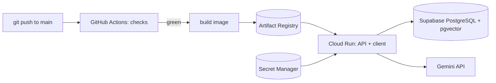

# Deployment runbook

How Shibutzim runs in production, and the one-time setup behind it. Architecture:
[architecture.md §10](architecture.md#10-deployment-and-operations).



- **One container** serves the API and the built client. It runs `alembic upgrade head` at start, then Uvicorn.
- **Release = a push to `main`.** The `ci` workflow runs server, client and image checks, then the `deploy` job
  builds the image, pushes it and deploys it. A pull request never deploys and never sees the cloud.
- **No stored cloud key.** GitHub proves its identity to Google with OpenID Connect (Workload Identity Federation);
  only a push to `main` of this repository may deploy.
- **Secrets** (`DATABASE_URL`, `JWT_SECRET`, `GEMINI_API_KEY`) live in Secret Manager and reach the container as
  environment variables. Nothing secret is in the repository, the image or a GitHub variable.

## What it costs

The setup stays inside Google's always-free monthly amounts for a demo (checked on 2026-11-12 at
[docs.cloud.google.com/free/docs/free-cloud-features](https://docs.cloud.google.com/free/docs/free-cloud-features);
Google may change them with 30 days' notice):

| Service | Free per month | This setup |
|---|---|---|
| Cloud Run | 2 million requests, 360,000 GB-seconds, 180,000 vCPU-seconds | scales to zero, at most 2 instances |
| Secret Manager | 6 active secret versions, 10,000 accesses | 3 versions |
| Artifact Registry | 0.5 GB | the last 3 images are kept |
| Supabase | free plan | pauses after a week without traffic |

Billing must be enabled on the project even though nothing should be charged. A **budget alert** (step 2) emails
at 50% and 100% of about one dollar. A budget only alerts; it does not stop spending. Outbound traffic beyond the free
amount is the one thing that could cost cents; a demo does not come close.

## One-time setup

Run from any directory with `gcloud` and `gh` logged in. Choose the names once:

```bash
export PROJECT_ID=shibutzim-demo-<something-unique>   # globally unique, lowercase
export REGION=europe-west3                            # Frankfurt, next to Supabase eu-central-1
export SERVICE=shibutzim
export REPO=shibutzim                                 # Artifact Registry repository
export GITHUB_REPO=Yosef-Perelman/Shibutzim
```

### 1. Project and billing

```bash
gcloud projects create "$PROJECT_ID" --name="Shibutzim"
gcloud billing accounts list                          # copy the ACCOUNT_ID of the card you use
gcloud billing projects link "$PROJECT_ID" --billing-account=<ACCOUNT_ID>
gcloud config set project "$PROJECT_ID"
export PROJECT_NUMBER=$(gcloud projects describe "$PROJECT_ID" --format='value(projectNumber)')
```

### 2. Budget alert

A budget must use the currency of the billing account (`gcloud billing accounts describe <ACCOUNT_ID>` shows it;
an Israeli account bills in ILS, where 4 ILS is about one dollar). It filters by project number, and the budget API
can take a minute to answer after it is enabled.

```bash
gcloud services enable billingbudgets.googleapis.com
gcloud billing budgets create --billing-account=<ACCOUNT_ID> --display-name="Shibutzim budget" \
  --budget-amount=1USD --threshold-rule=percent=0.5 --threshold-rule=percent=1.0 \
  --filter-projects="projects/$PROJECT_NUMBER" --billing-project="$PROJECT_ID"   # use 4ILS for an ILS account
```

### 3. APIs

```bash
gcloud services enable run.googleapis.com artifactregistry.googleapis.com secretmanager.googleapis.com \
  iam.googleapis.com iamcredentials.googleapis.com sts.googleapis.com
```

### 4. Artifact Registry, keeping only the last three images

```bash
gcloud artifacts repositories create "$REPO" --repository-format=docker --location="$REGION" \
  --description="Shibutzim images"
cat > /tmp/cleanup.json <<'JSON'
[
  {"name": "delete-old", "action": {"type": "Delete"}, "condition": {"tagState": "any"}},
  {"name": "keep-last-three", "action": {"type": "Keep"}, "mostRecentVersions": {"keepCount": 3}}
]
JSON
gcloud artifacts repositories set-cleanup-policies "$REPO" --location="$REGION" \
  --policy=/tmp/cleanup.json --no-dry-run
```

### 5. Two service accounts

The **runtime** account runs the container and may read only the three secrets. The **deployer** account is what
GitHub impersonates; it may deploy and push images, and nothing else.

```bash
gcloud iam service-accounts create shibutzim-run --display-name="Shibutzim runtime"
gcloud iam service-accounts create shibutzim-deploy --display-name="Shibutzim deployer (GitHub)"
export RUNTIME_SA="shibutzim-run@$PROJECT_ID.iam.gserviceaccount.com"
export DEPLOY_SA="shibutzim-deploy@$PROJECT_ID.iam.gserviceaccount.com"

gcloud projects add-iam-policy-binding "$PROJECT_ID" --member="serviceAccount:$DEPLOY_SA" --role=roles/run.admin
gcloud projects add-iam-policy-binding "$PROJECT_ID" --member="serviceAccount:$DEPLOY_SA" --role=roles/artifactregistry.writer
gcloud iam service-accounts add-iam-policy-binding "$RUNTIME_SA" \
  --member="serviceAccount:$DEPLOY_SA" --role=roles/iam.serviceAccountUser
```

### 6. Workload Identity Federation

Only workflows of this repository, on `main`, may impersonate the deployer.

```bash
gcloud iam workload-identity-pools create github --location=global --display-name="GitHub Actions"
gcloud iam workload-identity-pools providers create-oidc github-actions --location=global \
  --workload-identity-pool=github --issuer-uri=https://token.actions.githubusercontent.com \
  --attribute-mapping="google.subject=assertion.sub,attribute.repository=assertion.repository,attribute.ref=assertion.ref" \
  --attribute-condition="assertion.repository=='$GITHUB_REPO' && assertion.ref=='refs/heads/main'"
gcloud iam service-accounts add-iam-policy-binding "$DEPLOY_SA" --role=roles/iam.workloadIdentityUser \
  --member="principalSet://iam.googleapis.com/projects/$PROJECT_NUMBER/locations/global/workloadIdentityPools/github/attribute.repository/$GITHUB_REPO"
export WIF_PROVIDER="projects/$PROJECT_NUMBER/locations/global/workloadIdentityPools/github/providers/github-actions"
```

### 7. The database (Supabase)

In the Supabase dashboard (by hand):

1. **New project**, region **Central EU (Frankfurt)**, a long generated database password (save it in a password
   manager).
2. **Connect → Session pooler**: copy the connection string. Cloud Run reaches the internet over IPv4 only; the
   direct host is IPv6, so the pooler is required. Use **session** mode (port 5432), not transaction mode, because
   the driver uses prepared statements.
3. Turn it into a SQLAlchemy URL: `postgresql+psycopg://postgres.<ref>:<password>@<pooler-host>:5432/postgres`.
   A password with special characters must be URL-encoded. The `vector` extension is created by the first
   migration; nothing to enable by hand.

### 8. Secrets

Typed or generated in your shell, never pasted into a chat, a file or a command line argument:

```bash
read -rs DATABASE_URL && printf %s "$DATABASE_URL" | gcloud secrets create database-url --data-file=-
python3 -c "import secrets; print(secrets.token_urlsafe(48), end='')" | gcloud secrets create jwt-secret --data-file=-
read -rs GEMINI_API_KEY && printf %s "$GEMINI_API_KEY" | gcloud secrets create gemini-api-key --data-file=-
for secret in database-url jwt-secret gemini-api-key; do
  gcloud secrets add-iam-policy-binding "$secret" \
    --member="serviceAccount:$RUNTIME_SA" --role=roles/secretmanager.secretAccessor
done
```

### 9. GitHub variables

None of these is secret, so they are repository **variables**, not secrets.

```bash
gh variable set GCP_PROJECT_ID --body "$PROJECT_ID"
gh variable set GCP_REGION --body "$REGION"
gh variable set ARTIFACT_REPO --body "$REPO"
gh variable set CLOUD_RUN_SERVICE --body "$SERVICE"
gh variable set GCP_WORKLOAD_IDENTITY_PROVIDER --body "$WIF_PROVIDER"
gh variable set GCP_DEPLOY_SERVICE_ACCOUNT --body "$DEPLOY_SA"
gh variable set GCP_RUNTIME_SERVICE_ACCOUNT --body "$RUNTIME_SA"
# Demo accounts offered on the login screen. Empty hides the switch (a real customer build).
gh variable set DEMO_USERS --body "dana@shibutzim.example,noa@shibutzim.example,omer@shibutzim.example,tamar@shibutzim.example,yonatan@shibutzim.example,lior@shibutzim.example"
```

### 10. Demo data and the handbook, once

From `server/`, pointing at the new database for these commands only:

```bash
cd server
export DATABASE_URL="<the SQLAlchemy URL from step 7>"
uv run alembic upgrade head
uv run python scripts/seed.py                 # the demo team; every demo user has the SEED_PASSWORD
read -rs GEMINI_API_KEY && export GEMINI_API_KEY
uv run python scripts/ingest_handbook.py      # embeds the handbook (uses the provider's quota)
unset DATABASE_URL GEMINI_API_KEY
```

The demo accounts, including a manager who can add and deactivate people, share a password that is public in the
README. The site holds demo data only; run the seed again to restore it.

## Releasing

Merge to `main` locally (the plan workflow), then push. The `ci` workflow runs and the `deploy` job follows.

```bash
git push origin main
gh run watch                                  # follow the run
gh run list --workflow ci --limit 3
```

To redeploy the same code without a new commit: `gh workflow run ci --ref main`.

The first deployment creates the service. Its address is in the job log and in:

```bash
gcloud run services describe "$SERVICE" --region "$REGION" --format='value(status.url)'
```

## Checking a deployment

```bash
URL=$(gcloud run services describe "$SERVICE" --region "$REGION" --format='value(status.url)')
curl -s "$URL/api/health"                     # {"status":"ok"}
curl -sI "$URL/me/shifts"                     # 200, text/html
gcloud run services logs read "$SERVICE" --region "$REGION" --limit 50
```

The first request after a quiet period is slow: Cloud Run starts a container, and a paused Supabase project has to
wake up. Resume a paused project from the Supabase dashboard.

## Rolling back

```bash
gcloud run revisions list --service "$SERVICE" --region "$REGION"
gcloud run services update-traffic "$SERVICE" --region "$REGION" --to-revisions=<previous-revision>=100
```

A migration is never undone by a rollback of the code. A change to the schema is therefore always additive for one
release (new column or table first, code that needs it next), so the previous revision still works against the new
schema.

## Taking it down

```bash
gcloud run services delete "$SERVICE" --region "$REGION"
gcloud projects delete "$PROJECT_ID"          # removes everything in the project, including the secrets
```

Pausing or deleting the Supabase project is done in its dashboard.

## Why it is shaped this way

| Choice | Reason |
|---|---|
| Migrations at container start | one revision serves a demo; Alembic takes a lock, so two cold starts cannot apply a migration twice. A separate Cloud Run job is the answer for several instances under real load. |
| Session pooler, not the direct host | Cloud Run has no IPv6 egress; transaction mode breaks prepared statements. |
| Variables, not secrets, in GitHub | nothing in them opens anything; the secrets stay in Secret Manager. |
| Condition on repository and `refs/heads/main` | a fork, a pull request or another branch cannot deploy. |
| Two service accounts | the deployer has no direct read access to secret values (it can still ship code, so protect `main`), and the running container cannot deploy. |
| `--max-instances=2` | caps cost and database connections if the address is shared widely. |
